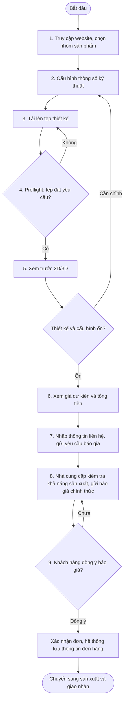

# Quy trình nghiệp vụ – E-Pack

## 1. Quy trình chính: Cấu hình sản phẩm, yêu cầu báo giá và đặt hàng

**Tác nhân tham gia:** Khách hàng (doanh nghiệp B2B, startup, shop online), Nhà cung cấp (xưởng in), Hệ thống E-Pack.

**Mục tiêu:** Giúp khách hàng tự cấu hình sản phẩm bao bì, kiểm tra thiết kế, nhận giá dự kiến, gửi yêu cầu báo giá và chốt đơn hàng với nhà cung cấp.

## 2. Các bước thực hiện

| Bước | Tên bước | Mô tả | Tác nhân | Chức năng liên quan |
|:----:|----------|-------|----------|---------------------|
| 1 | Truy cập website và chọn nhóm sản phẩm | Khách hàng truy cập nền tảng E-Pack và lựa chọn nhóm sản phẩm cốt lõi (hộp giấy, túi giấy, tube giấy hoặc nhãn in). | Khách hàng | F01, F02 |
| 2 | Cấu hình thông số kỹ thuật | Khách hàng tự nhập và lựa chọn các thông số chi tiết: kích thước (dài, rộng, cao/đường kính), loại chất liệu, định lượng giấy, số lượng đặt, số màu in và yêu cầu gia công hoàn thiện (cán mờ, ép kim, dập nổi, phủ UV). | Khách hàng | F03 |
| 3 | Tải lên tệp thiết kế | Khách hàng tải tệp thiết kế lên hệ thống (hỗ trợ PNG, JPG, SVG, PDF, AI). | Khách hàng | F04 |
| 4 | Kiểm tra tệp thiết kế (Preflight cơ bản) | Hệ thống tự động kiểm tra cơ bản các tiêu chí của tệp: định dạng, dung lượng, độ phân giải (dpi), tỷ lệ khung. | Hệ thống | F04 |
| 5 | Xem trước sản phẩm 2D/3D | Khách hàng quan sát bản xem trước ở chế độ 2D (kiểm tra bố cục từng mặt và vùng an toàn) và 3D (xoay, phóng to/thu nhỏ mô hình) để rà soát lỗi trước khi sản xuất. | Khách hàng, Hệ thống | F05 |
| 6 | Kiểm tra số lượng và tổng tiền dự kiến | Dựa trên cấu hình đã chọn, hệ thống tự động tính và hiển thị mức giá tham khảo (đơn giá và tổng chi phí dự kiến) giúp khách hàng cân đối ngân sách. | Hệ thống, Khách hàng | F06, F09 |
| 7 | Nhập thông tin đặt hàng và gửi yêu cầu báo giá | Sau khi rà soát, khách hàng điền thông tin liên hệ và bấm gửi yêu cầu. Toàn bộ cấu hình và tệp thiết kế được hệ thống lưu vết và chuyển tiếp đến nhà cung cấp. | Khách hàng, Hệ thống | F06 |
| 8 | Nhà cung cấp tiếp nhận và gửi báo giá chính thức | Xưởng in tiếp nhận thông tin cấu hình, kiểm tra khả năng sản xuất và gửi báo giá chính thức lại cho khách hàng qua hệ thống. | Nhà cung cấp | F07 |
| 9 | Xác nhận đơn hàng và lưu thông tin | Khách hàng xem xét báo giá chính thức. Sau khi thống nhất điều kiện, đơn hàng được xác nhận chính thức, hệ thống lưu thông tin đơn hàng và chuyển sang giai đoạn sản xuất, giao nhận. | Khách hàng, Nhà cung cấp, Hệ thống | F08 |

## 3. Sơ đồ luồng

## 4. Các tình huống rẽ nhánh

- **Tệp thiết kế không đạt Preflight (bước 4):** hệ thống báo lỗi cụ thể (định dạng, dung lượng, dpi, tỷ lệ khung) để khách hàng tải lại tệp khác.
- **Phát hiện lỗi khi xem trước (bước 5):** khách hàng quay lại chỉnh cấu hình hoặc thay thiết kế trước khi xem giá.
- **Báo giá chưa được chấp nhận (bước 9):** khách hàng và nhà cung cấp trao đổi, điều chỉnh qua hệ thống cho đến khi thống nhất điều kiện.

## 5. Ghi chú

- Giá ở bước 6 chỉ là giá tham khảo; giá chính thức do nhà cung cấp gửi ở bước 8.
- Thanh toán trực tuyến (Escrow), theo dõi vận chuyển và tạo khuôn bế tự động (F10) thuộc giai đoạn mở rộng, nằm sau bước 9.
